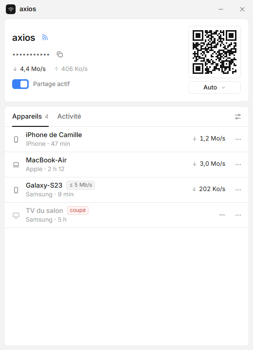
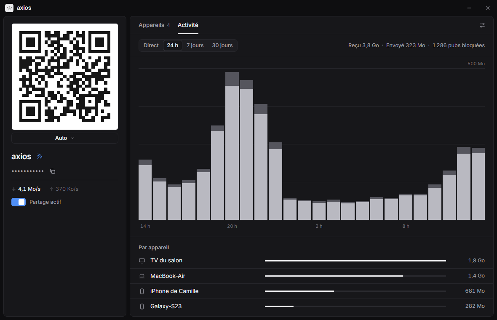

# axios

**Partagez la connexion Wi-Fi de votre PC Windows, même quand le réseau l'empêche.**

Sur certains réseaux, le partage de connexion de Windows connecte bien le téléphone… mais sans internet.
axios corrige ce problème et ajoute ce qui manque à Windows : voir les appareils connectés, leur couper
internet, limiter leur débit, bloquer les publicités, suivre la consommation.

<p align="center">
  
  &nbsp;
  
</p>

## Télécharger

**[⬇ Télécharger la dernière version](https://github.com/0xManusdev/axios/releases/latest)**, puis prenez
`axios_…_x64-setup.exe`. Lancez-le : axios s'installe en quelques secondes et apparaît dans le menu Démarrer.

| Fichier | Pour qui |
| --- | --- |
| `axios_…_x64-setup.exe` | La plupart des gens : installeur, raccourci, désinstallation propre |
| `axios_…_x64_portable.exe` | La même application, à lancer directement, sans installation |
| `axios-auto_…_x64.exe` | Version sans interface : double-cliquez une fois, puis utilisez le bouton « Point d'accès mobile » de Windows comme d'habitude |

**Au premier lancement**

- **« Windows a protégé votre ordinateur »** (SmartScreen) : l'exécutable n'est pas encore signé.
  Cliquez sur *Informations complémentaires*, puis *Exécuter quand même*.
- **Droits administrateur** : Windows les demande à chaque ouverture. Ils sont nécessaires au pilote
  réseau qui relaie le trafic (voir plus bas).
- **Antivirus** : certains antivirus signalent WinDivert, le pilote réseau utilisé, comme un « outil de
  piratage », parce qu'il permet d'intercepter des paquets. axios embarque la version officielle 2.2 de
  WinDivert, non modifiée. Si votre antivirus la bloque, ajoutez une exception pour
  `%LOCALAPPDATA%\PartageWiFi`.

**Configuration requise** : Windows 10 ou 11, 64 bits, carte Wi-Fi compatible avec le point d'accès mobile
de Windows.

## Fonctionnalités

- **Partage en un geste** : un interrupteur, le nom du réseau modifiable directement, le mot de passe, un
  QR code à scanner pour se connecter.
- **Appareils** : nom, fabricant, adresse, débit en direct, consommation. Pour chacun : le renommer, lui
  couper internet, limiter son débit.
- **Activité** : débit en direct et historique sur 24 heures, 7 jours et 30 jours, par appareil.
- **Protection** : bloqueur de publicités pour tous les appareils connectés, isolation (aucun accès au PC
  ni au réseau local), débit maximal par défaut.
- **Avancé** : DNS imposé (Cloudflare, Google ou personnalisé), point d'accès toujours allumé, relance
  automatique après une coupure du Wi-Fi.
- **Bande Wi-Fi** : 2,4 GHz, 5 GHz ou automatique. Les bandes incompatibles avec votre connexion sont
  signalées.
- **Confort** : thème clair ou sombre (ou celui de Windows), taille de l'interface réglable, démarrage
  avec Windows, notification à la connexion d'un appareil.

## Pourquoi le partage de Windows ne suffit pas

Certains routeurs (des MikroTik, par exemple) envoient tous leurs paquets avec une durée de vie
(**TTL**) de 1. C'est une façon simple d'empêcher le partage de connexion. Quand Windows relaie un tel
paquet vers le téléphone, il décrémente ce compteur, qui tombe à 0 : le paquet est jeté et le téléphone
reste sans internet.

Windows ne permet pas de modifier le TTL des paquets reçus. axios contourne donc le problème : il
intercepte le trafic des appareils avant le routage de Windows ([WinDivert](https://reqrypt.org/windivert.html))
et c'est le PC lui-même qui ouvre les connexions vers internet (proxy TCP transparent, sessions UDP,
DNS). Pour le routeur, tout le trafic vient du PC ; pour le téléphone, internet fonctionne normalement.
C'est aussi ce qui permet le blocage, les limites de débit et le filtrage DNS par appareil.

## Limites connues

- **8 appareils au plus** : c'est la limite du point d'accès mobile de Windows.
- **Une seule bande** : la carte Wi-Fi n'a qu'une radio. Le point d'accès doit utiliser la même bande que
  le Wi-Fi auquel le PC est connecté (« Auto » choisit la bonne).
- **IPv4 uniquement.**
- **Bloqueur de publicités** : il est contourné par les téléphones qui utilisent leur propre DNS chiffré
  (« DNS privé » d'Android, par exemple).

## Compiler depuis les sources

Prérequis : Windows, [Rust](https://rustup.rs) stable (MSVC), [Node.js](https://nodejs.org) 20 ou plus.

```powershell
git clone https://github.com/0xManusdev/axios.git
cd axios\app
npm ci
npx tauri build          # installeur dans target\release\bundle\nsis\
```

- `npx tauri dev` lance l'application en développement.
- `npm run dev` ouvre l'interface seule dans le navigateur, avec des données simulées.
- `cargo test --workspace` et `cargo clippy --workspace --all-targets` à la racine.

Sous Git Bash, `link.exe` de Git peut masquer celui de Visual Studio : compilez depuis PowerShell.

Pour publier une version : `git tag v0.2.0 && git push origin v0.2.0`. GitHub compile l'application et
attache les exécutables à la release ([workflow](.github/workflows/release.yml)).

## Organisation du code

| Dossier | Rôle |
| --- | --- |
| `crates/engine` | Moteur réseau : capture WinDivert, NAT, proxy TCP, UDP, DNS, politique par appareil |
| `crates/winsys` | Intégrations Windows : point d'accès, réseau, pare-feu, Wi-Fi, démarrage automatique |
| `crates/support` | Briques communes : journal, emplacements, pilote embarqué |
| `crates/auto` | Version sans interface (`axios-auto`) |
| `app/src-tauri` | Application (Tauri 2) : commandes, réglages, appareils, historique |
| `app/src` | Interface (TypeScript, sans framework) |
| `vendor/windivert` | WinDivert 2.2 officiel et sa licence |

L'architecture est détaillée dans [CONTRACT.md](CONTRACT.md) et [CONTRACT-V2.md](CONTRACT-V2.md).

Les réglages et l'historique sont enregistrés dans `%LOCALAPPDATA%\PartageWiFi\`. Le journal se trouve
dans `logs\partage-wifi.log`.

## Licences

axios est distribué sous licence MIT. WinDivert est distribué sous double licence LGPL v3 / GPL v2 (voir
[`vendor/windivert/LICENSE`](vendor/windivert/LICENSE)).
